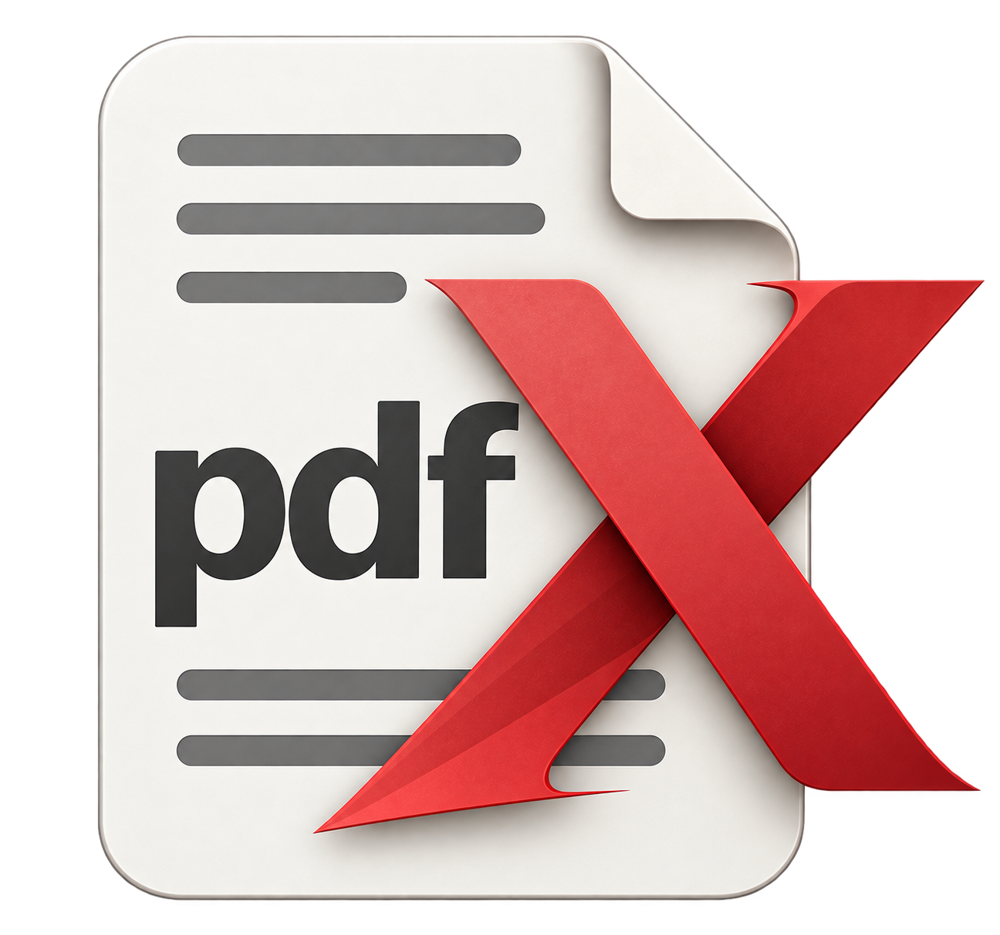
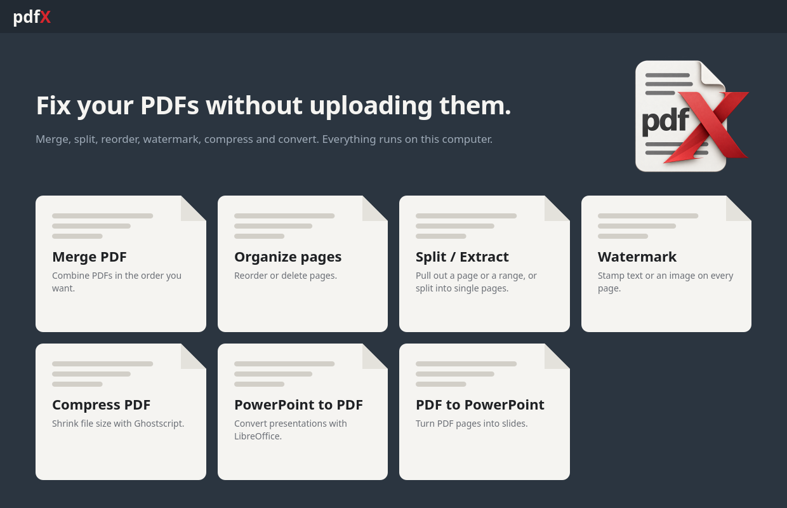
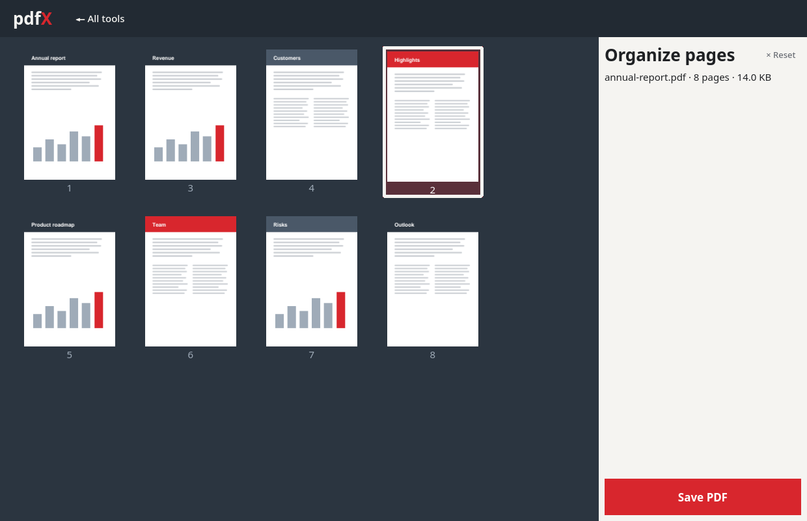
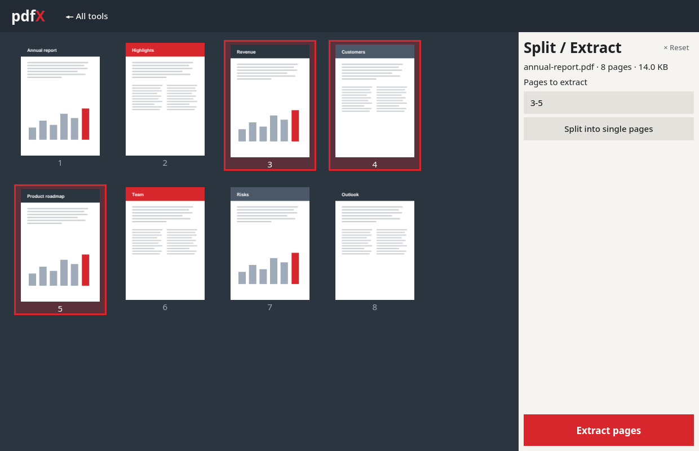

<div align="center">



# pdfX

**A desktop toolkit for everyday PDF jobs. Your files never leave your computer.**

Merge, reorder, split, watermark, compress and convert PDFs with a visual page editor, on Windows and Linux.


</div>

<br>



## Why pdfX

Online PDF tools ask you to upload your contracts, invoices and ID scans to someone else's server. pdfX does the same jobs in a desktop app, so nothing is uploaded and it works offline.

You see your pages as thumbnails, drag them into order, and save. No accounts, no file-size caps, and nothing added to your output.

## Features

### Merge PDFs
Combine any number of PDFs into one. Each file appears as a card with a preview of its first page and its page count. Drag the cards into the order you want.

### Organize pages
Open a PDF and see every page. Drag pages to reorder them, or select pages and press <kbd>Delete</kbd> to remove them. Save the result as a new PDF.

<table>
  <tr>
    <td width="50%"></td>
    <td width="50%"></td>
  </tr>
  <tr>
    <td align="center"><sub>Reordering pages. Here page 2 was picked up and moved two places.</sub></td>
    <td align="center"><sub>Selecting pages fills in the range automatically.</sub></td>
  </tr>
</table>

### Split and extract
Pull out a single page or a range, in one of two ways:
- **Click the pages** you want and the range box fills itself in.
- **Type a range** such as `3`, `2-5` or `1,4,7-9`. Typing selects the matching pages so you can check them.

Or split the whole document into single-page files in one click. A range written backwards (`5-2`) extracts those pages in reverse order.

### Watermark
Stamp text or an image across every page.
- **Text:** choose the wording, font size, opacity and rotation.
- **Image:** use a PNG or JPEG logo. Transparency in PNGs is kept. Choose its size, opacity and rotation.

### Compress
Shrink large PDFs with Ghostscript at three levels: less compression for best quality, a recommended middle setting, and extreme compression for the smallest file. pdfX reports the before and after sizes. If compressing wouldn't make the file smaller, it saves your original untouched instead of a bigger copy.

### PowerPoint to PDF
Convert `.pptx`, `.ppt`, `.pps`, `.ppsx` and `.odp` presentations to PDF, several at once, using LibreOffice running in the background.

### PDF to PowerPoint
Turn a PDF into a `.pptx` in either of two modes:
- **Editable:** text stays real text and shapes stay shapes, so you can keep working on the slides in PowerPoint. Complex layouts can shift, and scanned pages stay as pictures.
- **Exact look:** each page becomes a full-slide picture. It looks identical to the PDF, but nothing is editable.

## Designed to be pleasant to use

- **See your pages.** Real thumbnails rendered by PDFium, drawn in the background so large files don't freeze the window.
- **Drag and drop.** Drop files onto any tool, and drag pages or files to reorder them.
- **Works from the keyboard too.** Press <kbd>Enter</kbd> on a page to pick it up, move it with the arrow keys (<kbd>Home</kbd> and <kbd>End</kbd> jump to the ends), and press <kbd>Enter</kbd> again to put it down.
- **Start over in one click.** Every tool has a Reset button that clears it.
- **Safe saves.** You can save over the file you opened. pdfX builds the new file in memory before writing it, so saving over the file you opened works.
- **Clear problems.** A password-protected, corrupt or missing file gives a plain message that says what's wrong.

## What it needs

pdfX handles merging, reordering, splitting, watermarking and image-mode PDF to PowerPoint on its own. Two features use free tools that do the heavy lifting.

| Feature | Needs |
| --- | --- |
| Compress | [Ghostscript](https://ghostscript.com/) |
| PowerPoint to PDF | [LibreOffice](https://www.libreoffice.org/download/download-libreoffice/) |
| PDF to PowerPoint, editable mode | [LibreOffice](https://www.libreoffice.org/download/download-libreoffice/) |

If LibreOffice isn't installed, the features that need it are greyed out. Clicking one shows a download link, and pdfX finds LibreOffice automatically once it's installed.

## Installation

Installers for Windows and a portable AppImage for Linux are coming soon.

<!-- TODO: add download and install steps once the executables are built. -->

### Run from source

You need Python 3.10 or newer.

```bash
git clone <this-repository-url>
cd pdfx

python -m venv .venv
source .venv/bin/activate        # Windows: .venv\Scripts\activate

pip install -e .
python -m pdfx
```

## Use it as a library

Everything the app does lives in `pdfx.core` with no GUI attached, so you can script it:

```python
import pdfx

pdfx.merge(["cover.pdf", "report.pdf"], "combined.pdf")
pdfx.extract("report.pdf", "2-5", "excerpt.pdf")
pdfx.reorder("report.pdf", [4, 0, 1, 2, 3], "new-order.pdf")      # 0-based page indexes
pdfx.watermark_text("report.pdf", "CONFIDENTIAL", "marked.pdf", opacity=0.25)
pdfx.compress("scan.pdf", "smaller.pdf", level="ebook")           # needs Ghostscript
pdfx.pdf_to_ppt("report.pdf", "slides.pptx", editable=False)
```

Problems with your input raise `pdfx.PdfxError`, with a message you can show to a user.

## Development

```bash
pip install -e ".[dev]"
pytest
```

The tests cover the PDF operations and drive the interface with simulated mouse and keyboard input. Tests that need Ghostscript or LibreOffice are skipped when those aren't installed. The GUI tests run without a display.

```
src/pdfx/
  core.py        PDF operations, no GUI code
  gui/
    app.py       main window and landing page
    tools.py     one page per tool
    widgets.py   thumbnail grid, page-sheet shape, background jobs
    theme.py     colours
tests/
```

## Built with

[PySide6](https://doc.qt.io/qtforpython-6/) (Qt) for the interface, [pypdf](https://github.com/py-pdf/pypdf) for page operations, [pypdfium2](https://github.com/pypdfium2-team/pypdfium2) for page previews, [ReportLab](https://www.reportlab.com/opensource/) for watermarks, [python-pptx](https://github.com/scanny/python-pptx) for slides, with [Ghostscript](https://ghostscript.com/) and [LibreOffice](https://www.libreoffice.org/) as optional helpers.

## Status

pdfX is developed and tested on Linux with Python 3.14. It is written to run on Windows as well, but Windows is not yet tested.

## License

pdfX is released under the [MIT License](LICENSE).
